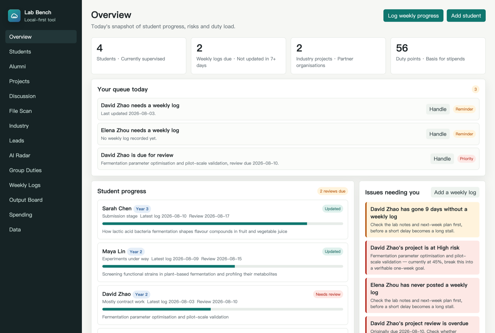
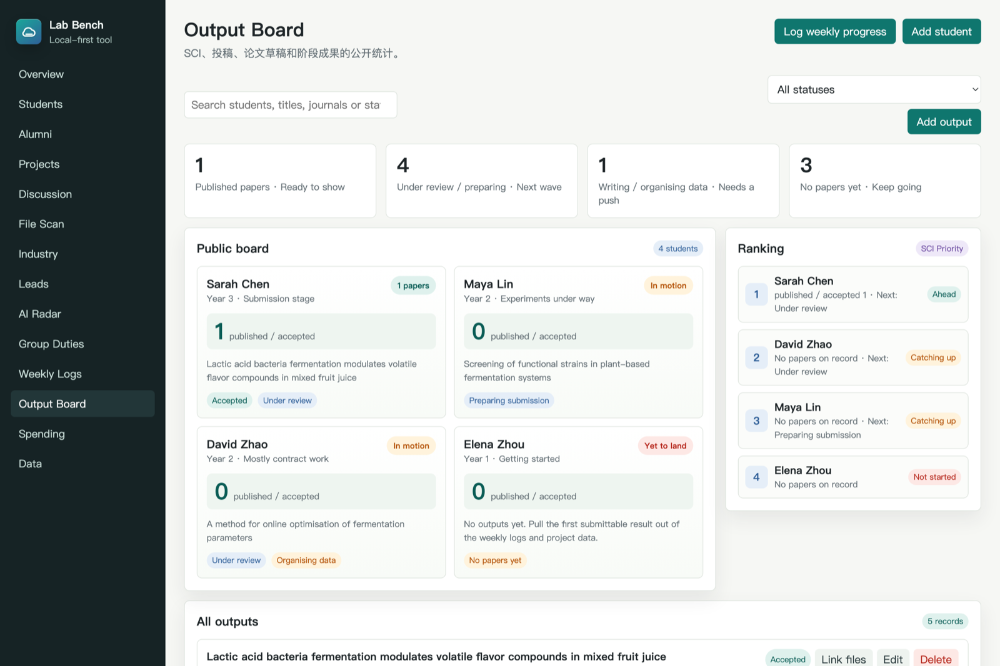
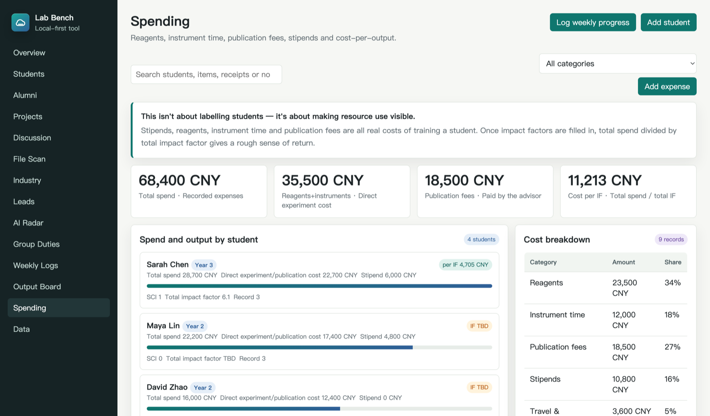
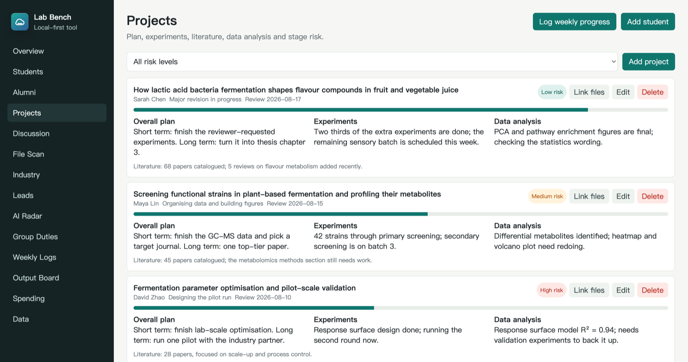

# Lab Bench

A local-first management tool for university research group leaders. Keeps track of graduate students, their projects, industry contracts, group duties, weekly progress, outputs and spending.

**No install, no dependencies, no server.** A handful of static files — double-click and it runs. Your data stays in your own browser and is never uploaded anywhere.

The interface is available in English and Chinese; switch any time from the bottom of the sidebar.

[](LICENSE)

[中文](README.md) · **English**



> Every screenshot in this document uses fictional demo data. No real people, organisations or publications are involved.

## Why this exists

Most academics supervising graduate students run on group chats, folders, and memory. How far along an experiment is, where a student is stuck, which draft the paper is on, how much was spent on consumables this term — it all lives in different places, and reconstructing it at the end of term means scrolling back through months of messages.

Commercial research management systems are either too heavy (built for a whole department) or want your data on someone else's server. This tool aims at something simpler: **a ledger for one research group that one person can actually keep up with**, with the data staying in your hands.

## Getting started

Download or clone this repository, then either:

**Option 1 (recommended)**: double-click `start-lab.command` and open `http://localhost:5299`.

**Option 2**: open `index.html` directly.

Or start it manually:

```bash
python3 -m http.server 5299 --bind 127.0.0.1
```

It ships with a small set of sample data (one student, one project, a weekly log, an output and an expense) so you can see how each module is meant to be used. Delete it, or reset it any time from the Data page.

> **Chrome or Edge recommended.** File Scan and file linking rely on the File System Access API, which Safari and Firefox don't support yet. Everything else works everywhere.

## Modules

| Module | What it's for |
| --- | --- |
| **Overview** | Student progress, overdue logs, risk alerts, duty points and your queue for today |
| **Students** | Year, expected graduation, status, contact details and what you're watching |
| **Alumni** | Where graduates went, current roles, contacts — your group's own alumni network |
| **Projects** | Plan, experiments, literature, data analysis, progress and risk |
| **Discussion** | Keyword graph generated from each project, plus a space for mechanism diagrams |
| **File Scan** | Point it at a student's folder; it finds new files and reads their contents |
| **Industry** | Partner organisations, contacts, student assignments and deliverables |
| **Leads** | Long-term tracking of external contacts and career openings for students |
| **Paper Radar** | Pulls papers from the last 30 days out of OpenAlex, Crossref and Europe PMC |
| **Group Duties** | Who did what, hours, points and status — a basis for allocating stipends |
| **Weekly Logs** | Experiments, data, literature, blockers, next-week plan and your feedback |
| **Output Board** | Papers, submissions and drafts per student, shown openly |
| **Spending** | Reagents, instrument time, publication fees, stipends and cost per unit of output |
| **Data** | JSON export/import, settings and in-browser backup history |

## A look at it

**Output Board** — every student's papers, submissions and drafts on one page. Making it visible to the whole group works better than chasing people privately.



**Spending** — consumables, instrument time, publication fees and stipends are all real costs of training someone. Fill in impact factors and you get a rough cost-per-IF.



**Projects** — plan, experiments, analysis and literature on a single card, with risk level and review date visible at a glance.



## Design decisions worth explaining

**File Scan reads file contents, not just filenames.** Grant access to a folder and it walks the tree, extracting text from `.txt` `.md` `.csv` `.json` `.docx` `.xlsx` and `.pdf`, then updates the archive snapshot and drafts a weekly log — which you have to approve before it becomes a real record.

PDF extraction is written from scratch with no dependencies (inflating FlateDecode streams and reading the text operators). **It handles most PDFs produced by Word, LaTeX and journal typesetters, but scanned documents and PDFs using CID fonts yield no text.** In that case it falls back to recording the filename only, rather than writing garbage into your archive.

**A folder name that doesn't match a student isn't a silent failure.** Unmatched folders are listed on the File Scan page; assign one to a student and the name is saved as an alias, recognised automatically from then on.

**Linked files store the filename and a text excerpt, not the file itself.** Browser storage is small; keeping binaries would fill it fast and make the exported backup unusable. So don't delete or move the originals.

**The backup warning is deliberately loud.** Data lives in localStorage, and clearing your browser wipes it. The daily automatic backup lives in the same place, so it won't save you — **only exporting a JSON file is a real backup**. If you haven't exported in 14 days, the front page says so.

## Data and privacy

Everything is stored in your browser's localStorage and never touches a server. The only network activity is the Paper Radar module calling public paper indexes (OpenAlex, Crossref, Europe PMC). No account is needed and none of your data is sent anywhere.

**Before switching browsers or machines, export a JSON backup from the Data page.**

## FAQ

**Port already in use?** Change the port in `start-lab.command`.

**How do several people use it?** Each on their own machine with their own data. Move data around with export/import on the Data page.

**Can I host it for a shared team?** Not as it stands — it's a purely client-side single-user app with no accounts or concurrency control, so it isn't suitable for the open internet. Fork it and add a backend if you need that.

**What does Paper Radar require?** An internet connection. It calls public APIs and needs no account.

## Contributing

Issues and pull requests are welcome. This grew out of running my own research group, so the feature choices reflect a particular way of working — if yours differs, please say so.

The bulk of the code is a single `app.js` with no build step; edit it and refresh the browser.

**Want to add a language?** You only touch `i18n.js`: copy the `EN` object, translate the values, register it in `DICTIONARIES`, and add a button to the switcher in the sidebar. Not a single line of `app.js` needs to change — the dictionary is keyed on the original Chinese strings, so the source still reads as natural sentences.

## Licence

[MIT](LICENSE). Free to use, modify and distribute, including commercially.

This was built to be given away to other academics supervising graduate students. If it saves you some time, that's the point.
