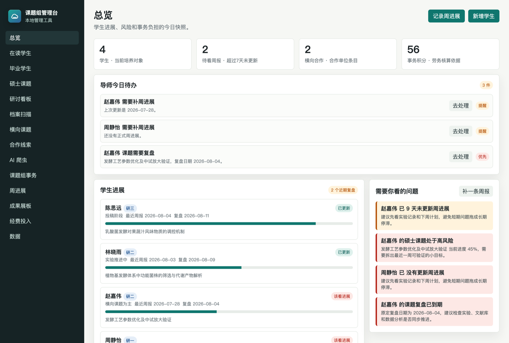
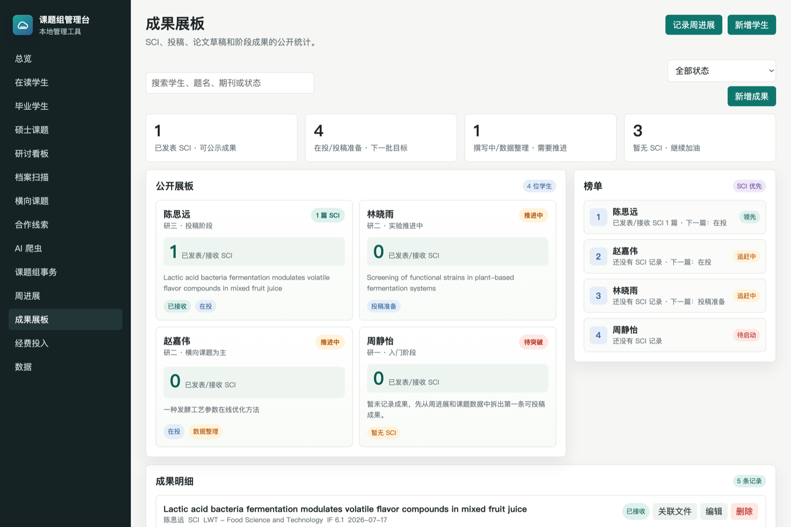
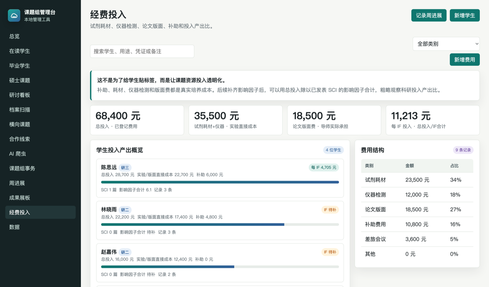
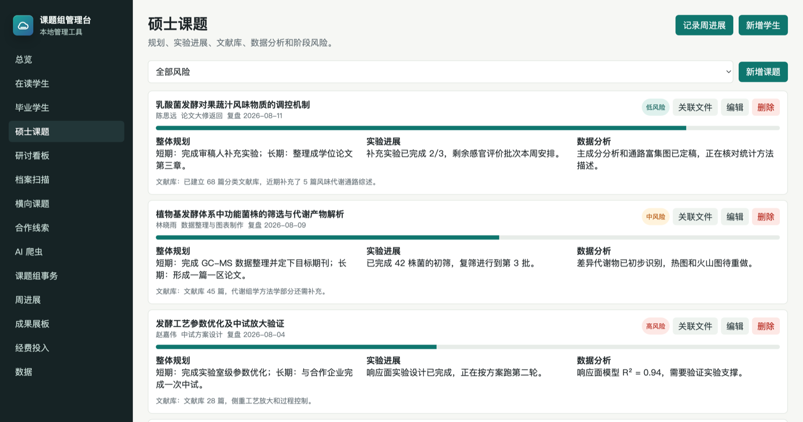

# Lab Bench 课题组管理台

面向高校课题组 PI（课题负责人）的本地管理工具。管理研究生、硕士课题、横向课题、组内事务、每周进展、成果和经费投入。

**零安装、零依赖、零服务器。** 一个 HTML + 一个 JS + 一个 CSS，双击就能用。数据只存在你自己电脑的浏览器里，不上传任何服务器。

[](LICENSE)



> 本文档所有截图均使用虚构的演示数据，不涉及任何真实人员、单位或成果。

## 为什么做这个

带研究生的老师大多在用微信群 + 文件夹 + 脑子记事。学生的实验进度、卡在哪里、论文写到第几稿、这学期花了多少耗材费——这些信息散在各处，学期末想复盘就得从头翻聊天记录。

商业的科研管理系统要么太重（面向整个学院），要么要把数据传到别人的服务器上。这个工具的定位很简单：**一个人就能用起来的课题组台账**，数据在自己手里。

## 快速开始

下载或克隆本仓库，然后二选一：

**方式一（推荐）**：双击 `start-lab.command`，浏览器打开 `http://localhost:5299`。

**方式二**：直接双击 `index.html`。

手动启动命令：

```bash
python3 -m http.server 5299 --bind 127.0.0.1
```

系统自带一套示例数据（一个示例学生、课题、周进展、成果和费用记录），方便你先摸清每个模块怎么用，之后可以在"数据"页一键恢复或直接删掉示例内容。

> **浏览器建议用 Chrome 或 Edge。** "档案扫描"和"关联文件"依赖 File System Access API，Safari 和 Firefox 目前不支持，其余功能不受影响。

## 功能模块

| 模块 | 用途 |
| --- | --- |
| **总览** | 学生进展、过期周报、风险提示、事务积分和导师今日待办 |
| **在读学生** | 年级、预计毕业、状态、联系方式和导师关注点 |
| **毕业学生** | 毕业去向、现任职位、联系方式——课题组自己的校友网络 |
| **硕士课题** | 整体规划、实验进展、文献库、数据分析、进度和风险 |
| **研讨看板** | 按课题关键词生成知识图谱，机制图讨论区 |
| **档案扫描** | 授权选择学生档案文件夹，自动识别新增文件并解析内容 |
| **横向课题** | 合作单位、合作老师、学生分工和交付物 |
| **合作线索** | 企业、科研院所、大学等外部合作与学生发展机会跟踪 |
| **AI 爬虫** | 按课题检索词从 OpenAlex、Crossref、Europe PMC 抓近 30 天新论文 |
| **课题组事务** | 事务量、小时数、积分和状态，可作为劳务费依据 |
| **周进展** | 每周记录实验、数据、文献、卡点、下周计划和导师反馈 |
| **成果展板** | SCI、投稿、论文草稿的公开统计，形成正向压力 |
| **经费投入** | 耗材、检测、版面费、补助，以及每 IF 投入的产出比 |
| **数据** | 导入导出 JSON 备份、规则设置、浏览器内历史备份 |

## 界面预览

**成果展板**——每位学生的 SCI、投稿和草稿状态摆在同一个页面上。公开可见能形成正向压力，比私下催进度有效。



**经费投入**——耗材、检测、版面费和补助都是真实培养成本。补齐影响因子后可以粗略看到每 IF 的投入。



**硕士课题**——规划、实验、数据分析和文献库集中在一张卡片上，风险等级和复盘日期一眼可见。



## 几个值得说明的设计

**档案扫描能读文件内容，不只是文件名。** 授权一个文件夹后，系统会递归扫描，解析 `.txt` `.md` `.csv` `.json` `.docx` `.xlsx` `.pdf` 的正文，据此更新档案快照并生成周进展候选稿——候选稿需要导师审核通过才进入正式记录。

PDF 解析是零依赖手写的（解 FlateDecode 流取文本操作符）。**能覆盖大部分由 Word、LaTeX 和期刊排版系统生成的 PDF，但扫描件和使用 CID 字体的 PDF 取不到文本**，这种情况会退回只记文件名，不会往档案里写乱码。

**文件夹名和学生姓名对不上时不会静默失败。** 没匹配上的文件夹会列在"档案扫描"页面，点一下就能指派给对应学生，指派后作为别名保存，以后自动识别。

**关联文件只存文件名和文本摘要，不存文件本身。** 浏览器存储容量有限，存二进制会很快撑爆，也会让导出的备份 JSON 无法使用。所以原文件请不要随意删除或移动。

**备份提醒是刻意做得显眼的。** 数据存在 localStorage 里，清一次浏览器缓存就全没了。系统里的"每日自动备份"同样存在浏览器里，救不了这种情况——**只有导出成 JSON 文件才是真备份**。超过 14 天没导出，首页会出现提醒。

## 数据与隐私

所有数据保存在当前浏览器的 localStorage 中，不经过任何服务器。唯一的联网行为是"AI 爬虫"模块调用公开论文索引 API（OpenAlex、Crossref、Europe PMC），不需要注册账号，也不会上传你的任何数据。

**换浏览器或换电脑前，务必在"数据"页导出 JSON 备份。**

## 常见问题

**端口被占用？** 修改 `start-lab.command` 里的端口号。

**多人怎么用？** 各自在自己电脑上用，各自维护自己课题组的数据。需要迁移时用"数据"页的导出/导入。

**能放到服务器上多人共享吗？** 当前版本是纯前端单机应用，没有账号体系和并发控制，不适合直接放公网。有这个需求建议 fork 后自行接后端。

**爬虫要什么条件？** 需要联网，调用的是公开 API，不用注册。

## 参与贡献

欢迎 Issue 和 PR。这个项目是我在带自己课题组的过程中一点点长出来的，功能取舍带有明显的个人偏好，如果你的使用场景不一样，非常欢迎提出来。

代码是单文件 `app.js`，没有构建步骤，改完刷新浏览器就能看到效果。

## 许可协议

[MIT](LICENSE)。可自由使用、修改和分发，包括商业用途。

做这个工具的初衷是给和我一样带研究生的高校老师免费用，如果它帮你省下了一些时间，我会很高兴。
