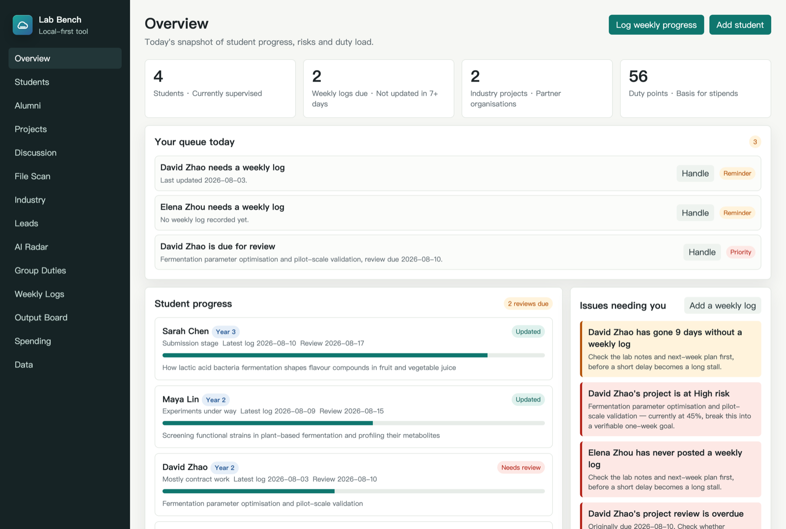
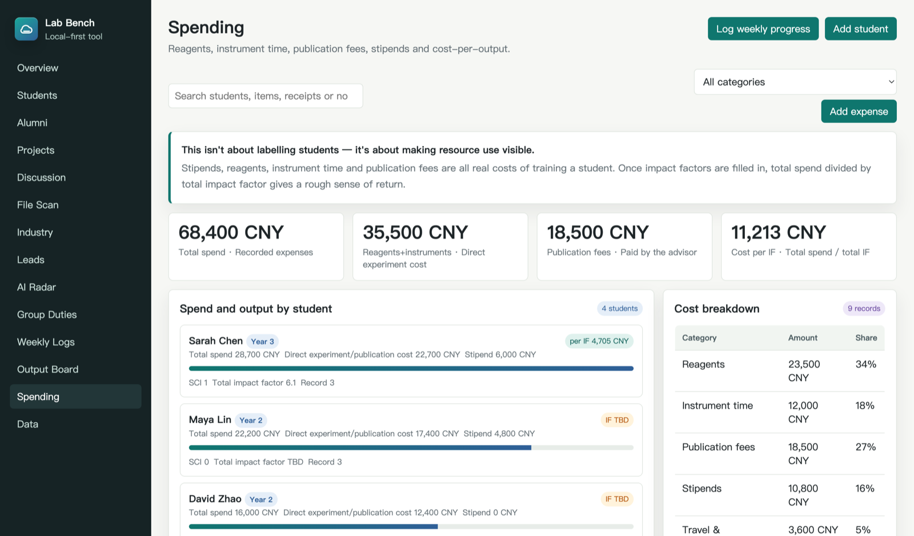

# Lab Bench 课题组管理台

面向高校课题组 PI（课题负责人）的本地管理工具。管理研究生、硕士课题、横向课题、组内事务、每周进展、成果和经费投入。

A local-first management tool for university research group leaders. Keeps track of graduate students, their projects, industry contracts, group duties, weekly progress, outputs and spending.

**自己部署，自己掌握数据。** 一台服务器 + 一个 sqlite 文件，学生和导师各自有账号，数据只在你自己的服务器上。也可以只在本机跑，一条命令启动。

**Self-hosted, your data stays yours.** One server and one sqlite file. Supervisor and students each get an account, and the data lives only on the machine you control. It also runs locally with a single command.

[](LICENSE)

> 本文档中英对照，所有截图均使用虚构的演示数据，不涉及任何真实人员、单位或成果。
>
> This document is bilingual. Every screenshot uses fictional demo data — no real people, organisations or publications are involved.

## 界面语言 · Interface language

界面支持中文和英文，侧边栏左下角随时切换，选择会记住。首次打开时按浏览器语言自动判断：中文环境用中文，其余用英文。

The interface is available in Chinese and English. Switch any time from the bottom of the sidebar; your choice is remembered. On first run it follows your browser language — Chinese locales get Chinese, everyone else gets English.




## 为什么做这个 · Why this exists

带研究生的老师大多在用微信群 + 文件夹 + 脑子记事。学生的实验进度、卡在哪里、论文写到第几稿、这学期花了多少耗材费——这些信息散在各处，学期末想复盘就得从头翻聊天记录。

Most academics supervising graduate students run on group chats, folders, and memory. How far along an experiment is, where a student is stuck, which draft the paper is on, how much was spent on consumables this term — it all lives in different places, and reconstructing it at the end of term means scrolling back through months of messages.

商业的科研管理系统要么太重（面向整个学院），要么要把数据传到别人的服务器上。这个工具的定位很简单：**一个人就能用起来的课题组台账**，数据在自己手里。

Commercial research management systems are either too heavy (built for a whole department) or want your data on someone else's server. This tool aims at something simpler: **a ledger for one research group that one person can actually keep up with**, with the data staying in your hands.

## 快速开始 · Getting started

下载或克隆本仓库，然后二选一：

Download or clone this repository, then either:

- **本机试用**：双击 `start-lab.command`。首次运行会自动装依赖、让你建一个导师账号，然后打开 `http://localhost:5299`。
  **Try it locally**: double-click `start-lab.command`. On first run it installs dependencies, asks you to create a supervisor account, then serves `http://localhost:5299`.
- **多人使用**：部署到你自己的服务器，见 [deploy/README.md](deploy/README.md)。
  **For a whole group**: deploy it on your own server — see [deploy/README.md](deploy/README.md).

需要 Python 3.9 以上。手动启动 · Requires Python 3.9+. Manual start:

```bash
python3 -m venv .venv && ./.venv/bin/pip install -r server/requirements.txt
./.venv/bin/python server/manage.py createadmin
cd server && ../.venv/bin/python -m uvicorn app:app --port 5299
```

系统自带一套示例数据（一个示例学生、课题、周进展、成果和费用记录），方便你先摸清每个模块怎么用，之后可以在"数据"页一键恢复或直接删掉示例内容。

It ships with a small set of sample data (one student, one project, a weekly log, an output and an expense) so you can see how each module is meant to be used. Delete it, or reset it any time from the Data page.

> **浏览器建议用 Chrome 或 Edge。** "档案扫描"和"关联文件"依赖 File System Access API，Safari 和 Firefox 目前不支持，其余功能不受影响。
>
> **Chrome or Edge recommended.** File Scan and file linking rely on the File System Access API, which Safari and Firefox don't support yet. Everything else works everywhere.

## 功能模块 · Modules

| 模块 Module | 用途 | What it's for |
| --- | --- | --- |
| **总览** Overview | 学生进展、过期周报、风险提示、事务积分和导师今日待办 | Student progress, overdue logs, risk alerts, duty points and your queue for today |
| **在读学生** Students | 年级、预计毕业、状态、联系方式和导师关注点 | Year, expected graduation, status, contact details and what you're watching |
| **目标与计划** Goals & Plans | 学生自己维护长短期目标和每周工作计划，导师逐条批注，学生可回复 | Students keep their own long- and short-term goals and weekly plans; you annotate them and they can reply |
| **合同管理** Contracts | 横向合同多版本存档，自动抽取关键日期和金额，确认后生成倒数日提醒 | Versioned industry contracts with key dates and amounts extracted automatically; confirm one and it becomes a countdown reminder |
| **毕业学生** Alumni | 毕业去向、现任职位、联系方式——课题组自己的校友网络 | Where graduates went, current roles, contacts — your group's own alumni network |
| **硕士课题** Projects | 整体规划、实验进展、文献库、数据分析、进度和风险 | Plan, experiments, literature, data analysis, progress and risk |
| **研讨看板** Discussion | 按课题关键词生成知识图谱，机制图讨论区 | Keyword graph generated from each project, plus a space for mechanism diagrams |
| **横向课题** Industry | 合作单位、合作老师、学生分工和交付物 | Partner organisations, contacts, student assignments and deliverables |
| **合作线索** Leads | 企业、科研院所、大学等外部合作与学生发展机会跟踪 | Long-term tracking of external contacts and career openings for students |
| **AI 爬虫** Paper Radar | 按课题检索词从 OpenAlex、Crossref、Europe PMC 抓近 30 天新论文 | Pulls papers from the last 30 days out of OpenAlex, Crossref and Europe PMC |
| **课题组事务** Group Duties | 事务量、小时数、积分和状态，可作为劳务费依据 | Who did what, hours, points and status — a basis for allocating stipends |
| **进展档案** Progress Archive | 周进展、候选稿、材料扫描和导师检查点合并展现 | Weekly logs, drafts, file scans and supervisor checkpoints in one view |
| **成果展板** Output Board | SCI、投稿、论文草稿的公开统计，形成正向压力 | Papers, submissions and drafts per student, shown openly |
| **经费投入** Spending | 耗材、检测、版面费、补助，以及每 IF 投入的产出比 | Reagents, instrument time, publication fees, stipends and cost per unit of output |
| **科研自动化** Research Automation | 原始数据、清洗、图表、统计、结果、讨论和导师审核的可视化流程 | A visible pipeline from raw data through cleaning, figures, statistics, writing and supervisor review |
| **NATURE Skills** | 开源科研技能库的来源、安装提示、使用边界和组内工作流入口 | Source, setup guidance, boundaries and lab workflow for the open-source research skill library |
| **数据** Data | 导入导出 JSON 备份、账号管理、规则设置 | JSON export/import, account management and settings |

## 界面预览 · A look at it

**成果展板**——每位学生的 SCI、投稿和草稿状态摆在同一个页面上。公开可见能形成正向压力，比私下催进度有效。

**Output Board** — every student's papers, submissions and drafts on one page. Making it visible to the whole group works better than chasing people privately.


**经费投入**——耗材、检测、版面费和补助都是真实培养成本。补齐影响因子后可以粗略看到每 IF 的投入。

**Spending** — consumables, instrument time, publication fees and stipends are all real costs of training someone. Fill in impact factors and you get a rough cost-per-IF.



**硕士课题**——规划、实验、数据分析和文献库集中在一张卡片上，风险等级和复盘日期一眼可见。

**Projects** — plan, experiments, analysis and literature on a single card, with risk level and review date visible at a glance.


## 几个值得说明的设计 · Design decisions worth explaining

**档案扫描能读文件内容，不只是文件名。** 授权一个文件夹后，系统会递归扫描，解析 `.txt` `.md` `.csv` `.json` `.docx` `.xlsx` `.pdf` 的正文，据此更新档案快照并生成周进展候选稿——候选稿需要导师审核通过才进入正式记录。

**File Scan reads file contents, not just filenames.** Grant access to a folder and it walks the tree, extracting text from `.txt` `.md` `.csv` `.json` `.docx` `.xlsx` and `.pdf`, then updates the archive snapshot and drafts a weekly log — which you have to approve before it becomes a real record.

PDF 解析是零依赖手写的（解 FlateDecode 流取文本操作符）。**能覆盖大部分由 Word、LaTeX 和期刊排版系统生成的 PDF，但扫描件和使用 CID 字体的 PDF 取不到文本**，这种情况会退回只记文件名，不会往档案里写乱码。

PDF extraction is written from scratch with no dependencies (inflating FlateDecode streams and reading the text operators). **It handles most PDFs produced by Word, LaTeX and journal typesetters, but scanned documents and PDFs using CID fonts yield no text.** In that case it falls back to recording the filename only, rather than writing garbage into your archive.

**文件夹名和学生姓名对不上时不会静默失败。** 没匹配上的文件夹会列在"档案扫描"页面，点一下就能指派给对应学生，指派后作为别名保存，以后自动识别。

**A folder name that doesn't match a student isn't a silent failure.** Unmatched folders are listed on the File Scan page; assign one to a student and the name is saved as an alias, recognised automatically from then on.

**关联文件只存文件名和文本摘要，不存文件本身。** 浏览器存储容量有限，存二进制会很快撑爆，也会让导出的备份 JSON 无法使用。所以原文件请不要随意删除或移动。

**Linked files store the filename and a text excerpt, not the file itself.** Browser storage is small; keeping binaries would fill it fast and make the exported backup unusable. So don't delete or move the originals.

**备份要自己安排。** 数据在服务器的 sqlite 文件里，`deploy/backup.sh` 可以挂 cron 每天备份，但**默认只备份到同一台机器上**——机器挂了就一起没了。建议同步一份到 OSS，或者定期从「数据」页导出 JSON 存到自己电脑。超过 14 天没导出，首页会提醒。

**Backups are on you.** The data is a sqlite file on the server. `deploy/backup.sh` can run daily from cron, but **it writes to the same machine by default** — if that machine dies, so does the backup. Sync a copy to object storage, or export a JSON from the Data page onto your own computer now and then. If you haven't exported in 14 days, the front page says so.

**学生账号是真鉴权，不是界面开关。** 口令用 argon2id 存（装不上时退到 pbkdf2-600k），会话 token 在库里只存哈希，连错 8 次锁 15 分钟，改口令会踢掉全部旧会话。学生能看什么、能改什么，全部在服务端判定——前端把按钮改出来也拿不到别人的数据。

**Student accounts are real authentication, not a UI toggle.** Passwords are hashed with argon2id (falling back to pbkdf2-600k), session tokens are stored only as hashes, eight failed attempts lock the account for fifteen minutes, and changing a password invalidates every existing session. What a student may read or write is decided server-side — editing the front-end buttons gets them nothing.

**合同抽取的结果一律要人确认。** OCR 和正则都会误读，所以抽出来的日期和金额先进"待确认"区，你点过之后才变成待办并开始倒数。抽取只认"日期 + 交付/验收/付款/截止"这类组合，签署日期和身份证有效期不会被塞进你的日程。

**Everything extracted from a contract needs your confirmation.** OCR and pattern matching both misread things, so extracted dates and amounts land in a pending list; only once you confirm one does it become a task and start counting down. Extraction only accepts a date paired with words like delivery, acceptance, payment or deadline — signature dates and ID expiry dates never end up in your schedule.

**数字版合同不需要 OCR。** 服务端会先读 PDF 的文本层和 docx 正文，Word 导出和电子签平台生成的合同直接就能抽。只有扫描件和拍照件才走 OCR；服务器没装 OCR 引擎时会明确告诉你"这是扫描件，请手动填写"，而不是假装没找到日期。

**Digital contracts need no OCR at all.** The server reads the PDF text layer and docx body first, so anything exported from Word or produced by an e-signature platform parses directly. OCR is only for scans and photos — and when no OCR engine is installed the app says so plainly rather than pretending it found no dates.

**科研自动化保存流程，不假装替你做完科研。** 学生可以登记自己的原始数据位置并维护流程节点，导师可以查看全组、给出返工意见并确认是否进入论文或成果展板。原始数据、清洗日志、统计依据、图表脚本和引用仍应保存在可回看的研究目录中。

**Research Automation stores the workflow; it does not pretend to complete the science for you.** Students can maintain their own data location and pipeline steps, while the supervisor can review the whole group, request rework and decide what is ready for a paper or the Output Board. Raw data, cleaning logs, statistical rationale, figure scripts and citations should remain in a reviewable research directory.

**NATURE Skills 以外部开源项目接入。** 上游仓库是 `Yuan1z0825/nature-skills`，采用 Apache-2.0；Lab-Bench 只提供入口、边界和工作流说明，不打包上游代码，也不会自动上传课题组数据。安装和更新前请阅读上游 README 与变更记录。

**NATURE Skills is linked as an external open-source project.** The upstream `Yuan1z0825/nature-skills` repository uses Apache-2.0. Lab-Bench provides the entry point, boundaries and workflow guidance without bundling upstream code or automatically uploading lab data. Read the upstream README and changes before installing or updating.

## 数据与隐私 · Data and privacy

数据保存在**你自己部署的那台服务器**上，不经过任何第三方。存的内容包括：学生和校友的姓名、年级、联系方式（含微信、邮箱）、课题与周进展、经费记录，以及你上传的横向合同原件和从中抽取的日期与金额。学生账号只能看到自己的那部分，这个限制在服务端强制，不是前端藏按钮。

唯一会自动对外联网的功能是"AI 爬虫"模块调用公开论文索引 API（OpenAlex、Crossref、Europe PMC），不需要注册账号，也不会上传你的数据。NATURE Skills 页面只有一个手动打开的 GitHub 链接；扫描件 OCR 在**你自己的服务器上**跑，合同不会发给任何云服务。

因为存了在校学生和校友的个人信息，请按《个人信息保护法》的要求处理：只收集必要信息，告知学生存了什么，离组后按需删除。

Data lives on **the server you deploy**, and passes through no third party. That includes student and alumni names, year, contact details (WeChat, email), projects and weekly logs, spending records, plus any industry contracts you upload and the dates and amounts extracted from them. Student accounts only ever see their own slice, enforced server-side rather than by hiding buttons in the UI.

The only automatic outbound traffic is Paper Radar calling public indexes (OpenAlex, Crossref, Europe PMC) — no account and no data uploaded. The NATURE Skills page contains only a manually opened GitHub link. OCR for scanned contracts runs **on your own server**; contracts are never sent to a cloud service.

Because this stores personal information about current students and alumni, handle it accordingly: collect only what you need, tell students what is stored, and delete records when people leave.

**服务器迁移或重装前，务必在"数据"页导出 JSON 备份。**

**Before migrating or rebuilding the server, export a JSON backup from the Data page.**

## 常见问题 · FAQ

**端口被占用？** 修改 `start-lab.command` 里的端口号。
**Port already in use?** Change the port in `start-lab.command`.

**多人怎么用？** 部署到一台服务器上，导师用管理员账号，学生账号由导师在「数据」页的「账号管理」里创建并绑定到学生档案，忘记口令也在那里重置。学生首次登录会被强制改掉初始口令。按 10 人以内的并发设计。
**How do several people use it?** Deploy it on one server. The supervisor holds the admin account and creates student accounts, each bound to a student record. Students must change their temporary password on first sign-in. Sized for up to about ten concurrent users.

**学生能看到什么？** 只有自己的档案、课题、周进展、目标和计划，以及导师给自己的批注。横向课题、经费、合同、其他同学的数据一概看不到——这是服务端拦的。
**What can a student see?** Only their own record, project, weekly logs, goals and plans, plus the notes their supervisor left them. Industry projects, spending, contracts and other students' data are all invisible — blocked server-side.

**放公网需要注意什么？** 必须配 HTTPS，否则口令是明文过网络的。中国大陆节点的 ECS 绑域名还要先完成 ICP 备案。详见 [deploy/README.md](deploy/README.md)。
**What do I need before exposing it to the internet?** HTTPS is mandatory — without it passwords cross the network in the clear. See [deploy/README.md](deploy/README.md).

**爬虫要什么条件？** 需要联网，调用的是公开 API，不用注册。
**What does Paper Radar require?** An internet connection. It calls public APIs and needs no account.

## 参与贡献 · Contributing

欢迎 Issue 和 PR。这个项目是我在带自己课题组的过程中一点点长出来的，功能取舍带有明显的个人偏好，如果你的使用场景不一样，非常欢迎提出来。

Issues and pull requests are welcome. This grew out of running my own research group, so the feature choices reflect a particular way of working — if yours differs, please say so.

代码主体是单文件 `app.js`，没有构建步骤，改完刷新浏览器就能看到效果。

The bulk of the code is a single `app.js` with no build step; edit it and refresh the browser.

**想加一门语言？** 只改 `i18n.js` 一个文件：复制里面的 `EN` 对象，把值翻译成目标语言，注册到 `DICTIONARIES`，再在侧边栏的切换器里加一个按钮。`app.js` 一行都不用动 —— 词典直接用中文原文当 key，所以源码读起来仍然是自然语句。

**Want to add a language?** You only touch `i18n.js`: copy the `EN` object, translate the values, register it in `DICTIONARIES`, and add a button to the switcher in the sidebar. Not a single line of `app.js` needs to change — the dictionary is keyed on the original Chinese strings, so the source still reads as natural sentences.

## 许可协议 · Licence

[MIT](LICENSE)。可自由使用、修改和分发，包括商业用途。

[MIT](LICENSE). Free to use, modify and distribute, including commercially.

做这个工具的初衷是给和我一样带研究生的高校老师免费用，如果它帮你省下了一些时间，我会很高兴。

This was built to be given away to other academics supervising graduate students. If it saves you some time, that's the point.
